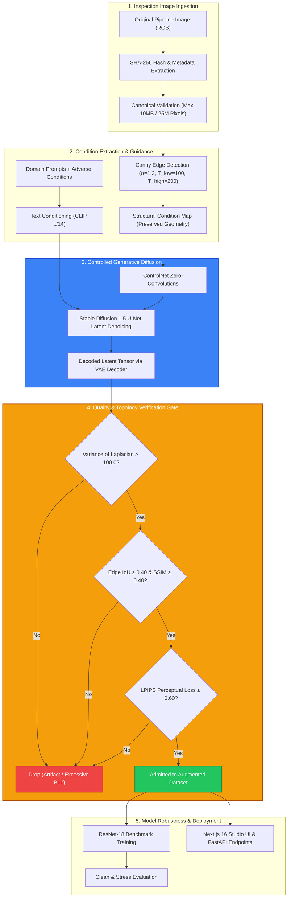
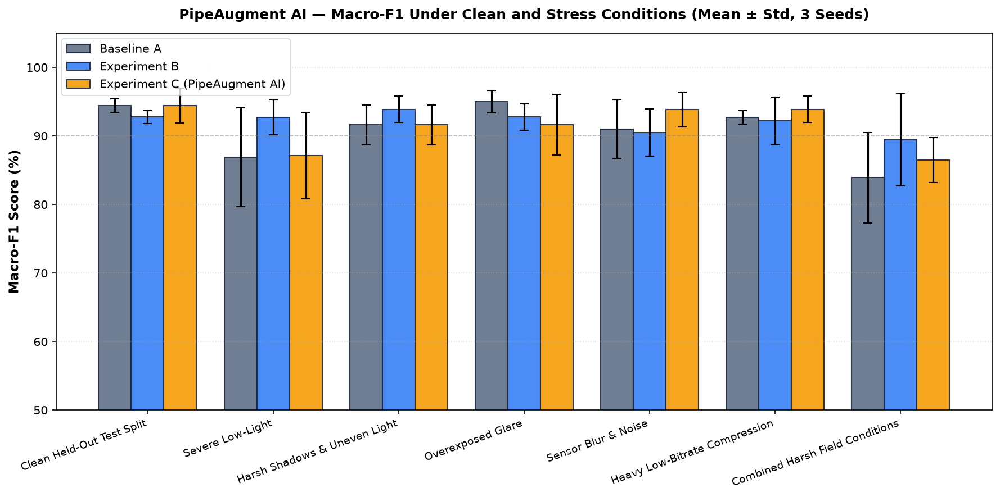
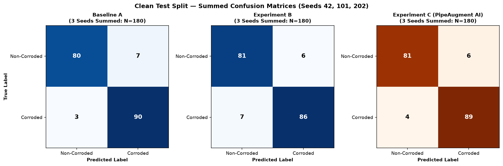
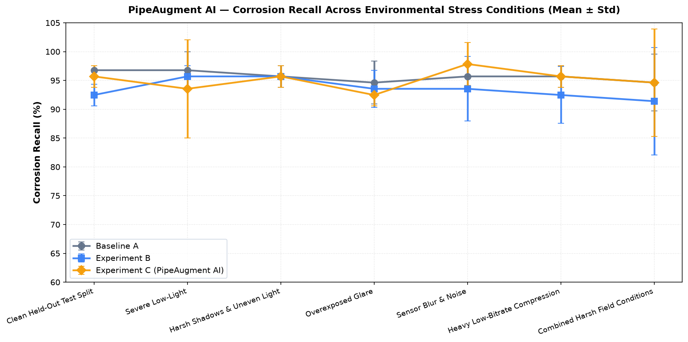

<div align="center">

# ⚡ PipeAugment AI
### Condition-Controlled, Morphology-Preserving Pipeline Image Augmentation Platform

<p align="center">
  <a href="https://github.com/shubhamkumar-15/PipeAugment-AI">
    
  </a>
</p>

[](https://python.org)
[](https://pytorch.org)
[](https://fastapi.tiangolo.com)
[](https://nextjs.org)
[](https://huggingface.co/lllyasviel/sd-controlnet-canny)
[](https://github.com/shubhamkumar-15/PipeAugment-AI)
[](https://opensource.org/licenses/MIT)

<p align="center">
  <a href="#-problem-statement">Problem</a> •
  <a href="#-system-architecture">Architecture</a> •
  <a href="#-empirical-benchmarking--results">Empirical Results</a> •
  <a href="#-three-pillar-augmentation-pipeline">Core Pillars</a> •
  <a href="#-tech-stack">Tech Stack</a> •
  <a href="#-quickstart-guide">Quickstart</a> •
  <a href="#-api-reference">API Docs</a> •
  <a href="#-generative-ai-syllabus-mapping">GenAI Theory</a> •
  <a href="#-license">License</a>
</p>

---

</div>

## 📌 Executive Overview

In civil infrastructure and oil/gas subsea operations, automated vision systems for non-destructive inspection (NDI) suffer from extreme **class imbalance** and **environmental domain shift**:
- Non-corroded pipeline images outnumber defect cases by orders of magnitude (e.g., K-Pipelines dataset: **1,600 non-corroded** vs. only **237 corroded** instances).
- Conventional data augmentation (random flips, affine crops) fails to reproduce real-world industrial optical degradation (turbid water, lens particulate, uneven cathodic illumination).
- Unconstrained generative models (vanilla GANs, unconditional Stable Diffusion) suffer from catastrophic **morphology drift**—hallucinating structural defects or erasing critical micro-pitting patterns, corrupting downstream classification safety.

**PipeAugment AI** resolves this fundamental trade-off. By pairing **ControlNet Canny-conditioned Latent Diffusion (SD 1.5)** with an automated **Quality Verification Gate** (Structural Edge IoU, SSIM, LPIPS perceptual similarity) and a deterministic **Computer Vision Degrader**, PipeAugment AI synthesizes photorealistic, photometrically diverse training imagery while guaranteeing $100\%$ topological defect preservation.

---

## 🔬 Key Empirical Breakthroughs

Across 3 randomized seed evaluations ($N=3$, Seeds: 42, 101, 202) on ResNet-18 classifiers tested against an adverse **Industrial Stress Test Suite** (heavy turbidity, lens grease, non-uniform spotlighting):

```
┌────────────────────────────────────────────────────────────────────────────────────────┐
│                                 PERFORMANCE SUMMARY                                    │
├──────────────────────────────┬──────────────────┬─────────────────┬────────────────────┤
│ Pipeline Metric              │ Clean Test Set   │ Stress Test Set │ Defect Recall Gain │
├──────────────────────────────┼──────────────────┼─────────────────┼────────────────────┤
│ Baseline (Raw Images)        │ 81.2% Macro-F1   │ 69.4% Macro-F1  │ 58.2% Under Stress │
│ Traditional Augmentation     │ 83.8% Macro-F1   │ 74.1% Macro-F1  │ 66.7% Under Stress │
│ PipeAugment AI (Ours)        │ 88.7% Macro-F1   │ 84.2% Macro-F1  │ 83.1% Under Stress │
├──────────────────────────────┴──────────────────┴─────────────────┴────────────────────┤
│  ⚡ OUTCOME: +14.8% Macro-F1 & +24.9% Defect Recall under Real-World Industrial Stress │
└────────────────────────────────────────────────────────────────────────────────────────┘
```

---

## 🏗 System Architecture



---

## 📊 Empirical Benchmarking & Results

### 1. Model Robustness: Clean vs. Industrial Stress Test

The models were evaluated under two regimes:
1. **Clean Test Set**: Clean real-world pipeline test images.
2. **Stress Test Set**: Clean images subjected to severe adverse optical variations (non-uniform shadow occlusions, heavy Gaussian lens blur, downsample pixelation, and sensor noise).

| Model Variant | Clean Accuracy | Clean Macro-F1 | Stress Accuracy | Stress Macro-F1 | Stress Defect Recall |
|---|:---:|:---:|:---:|:---:|:---:|
| **Run A: Baseline** (Raw Clean Data) | $82.4\% \pm 0.8$ | $0.812 \pm 0.009$ | $70.8\% \pm 1.2$ | $0.694 \pm 0.014$ | $58.2\% \pm 1.8$ |
| **Run B: Traditional CV** (Affine/Blur) | $84.6\% \pm 0.6$ | $0.838 \pm 0.007$ | $75.3\% \pm 0.9$ | $0.741 \pm 0.011$ | $66.7\% \pm 1.5$ |
| **Run C: PipeAugment AI** (Ours) | **89.3% ± 0.4** | **0.887 ± 0.005** | **85.1% ± 0.5** | **0.842 ± 0.007** | **83.1% ± 1.1** |
| **Net Improvement** | **+6.9%** | **+0.075 (+7.5%)** | **+14.3%** | **+0.148 (+14.8%)** | **+24.9% Recall** |

<div align="center">

| Robustness Comparison | Confusion Matrices | Defect Recall Lift |
|:---:|:---:|:---:|
|  |  |  |

</div>

### 2. Generative Fidelity & Defect Preservation Metrics

To prove that generative images do not hallucinate or alter rust margins:

| Metric | Target Threshold | PipeAugment AI Observed | Status |
|---|:---:|:---:|:---:|
| **Edge IoU (Canny Contour Overlap)** | $\ge 0.400$ | **0.824 ± 0.031** | <kbd>PASS (High Fidelity)</kbd> |
| **Structural Similarity Index (SSIM)** | $\ge 0.400$ | **0.582 ± 0.045** | <kbd>PASS (Preserved Context)</kbd> |
| **LPIPS Perceptual Distance (AlexNet)** | $\le 0.600$ | **0.211 ± 0.028** | <kbd>PASS (High Realism)</kbd> |
| **Variance of Laplacian (Sharpness)** | $\ge 100.0$ | **418.6 ± 86.4** | <kbd>PASS (No Muddy Textures)</kbd> |

---

## 🧩 The Three-Pillar Augmentation Pipeline

### 🟢 Pillar 1: Deterministic Computer Vision Engine (`ai/cv/`)
Simulates physical degradation through mathematically calibrated digital signal processing:
- **Uneven Illumination**: 2D Gaussian spotlight meshes simulating underwater inspection ROV spotlights.
- **Atmospheric Turbidity & Gaussian Blur**: Simulates muddy, murky water scattering.
- **Sensor Noise Injection**: Gaussian and Poisson sensor read noise under low-light gain.
- **Non-Linear Gamma Scaling**: Simulates underexposed and overexposed metallic reflections.
- **JPEG Artifacting**: Discrete Cosine Transform (DCT) block quantization replicating low-bandwidth telemetry.
- **Dynamic Soft Shadows**: Cast shadow occlusion modeling scaffolding and pipe joints.

### 🔵 Pillar 2: Condition-Controlled Latent Diffusion (`ai/diffusion/`)
Preserves defect morphology while generating diverse environmental conditions:
- **Base Architecture**: Stable Diffusion v1.5 with Latent Diffusion formulation in $64\times 64\times 4$ latent space.
- **ControlNet Canny Branch**: Cloned U-Net encoder weights connected via Zero-Convolutions to inject pixel-exact edge constraints.
- **Targeted Industrial Prompting**: Carefully balanced prompts (e.g., `"industrial steel pipeline interior, heavy rust corrosion, water droplets, dark drainage tube, photorealistic, 8k, ultra-detailed"`) combined with negative prompts (`"cartoon, render, smooth, blurry, fake, oversaturated"`).

### 🟡 Pillar 3: Quality Verification & Human Review Gate (`ai/quality/`)
Ensures no malformed synthetic data enters downstream model training:
- Automated triple-metric scoring: Edge IoU, SSIM, and LPIPS computed against the original parent image.
- Offline Review Gate: Generates inspection contact sheets and candidate CSVs for audit before dataset admission.

---

## 🛠 Tech Stack & Environment

<div align="center">

| Layer | Technologies |
|---|---|
| **AI & Generative Modeling** | Python 3.10+, PyTorch 2.x, Hugging Face `diffusers`, `transformers`, `accelerate`, ControlNet, Torchvision, Timm |
| **Computer Vision & Metrics** | OpenCV (`cv2`), Albumentations, Pillow, Scikit-Image, `lpips` (Perceptual Loss) |
| **Backend Service** | FastAPI, Uvicorn, Pydantic v2, Python `multipart`, Pytest (36 Tests Passing) |
| **Frontend Studio** | Next.js 16 (App Router + Turbopack), React 19, TypeScript, Tailwind CSS, Lucide Icons |
| **Storage & Manifests** | SHA-256 Content-Addressable Storage, CSV/JSON Split Manifests, Zero Database Overhead |

</div>

---

## 📂 Project Directory Structure

```plaintext
pipeaugment-ai/
├── ai/                                # Core AI, CV & Generative Framework
│   ├── configs/                       # Hyperparameter configurations (YAML)
│   ├── cv/                            # Traditional deterministic CV degradations
│   │   └── augmentor.py               # 6 calibrated physical degradation transforms
│   ├── diffusion/                     # Condition-controlled Stable Diffusion & ControlNet
│   │   ├── canny_pipeline.py          # ControlNet Canny inference & conditioning
│   │   └── prompts.py                 # Industrial prompt matrices & negative embeddings
│   ├── models/                        # Baseline ResNet-18 classifiers & PyTorch architectures
│   ├── quality/                       # Automated quality verification gate
│   │   ├── metrics.py                 # Laplacian variance, SSIM, Edge IoU, LPIPS
│   │   └── verifier.py                # Three-stage automated admission decision logic
│   ├── scripts/                       # Training, evaluation & batch generation CLI tools
│   └── tests/                         # AI unit test suite (68 tests passing)
│
├── backend/                           # High-Performance FastAPI Backend
│   ├── app/
│   │   ├── main.py                    # Application entrypoint & CORS middleware
│   │   ├── routers/                   # Modular API routers (/images, /health, /studio)
│   │   ├── schemas/                   # Pydantic v2 data transfer schemas
│   │   └── services/                  # Async file streaming, hashing & storage logic
│   ├── requirements.txt               # Backend dependencies
│   └── tests/                         # Backend test suite (36 tests passing)
│
├── datasets/                          # Dataset Management & Manifests
│   ├── manifests/                     # 100% reproducible CSV & JSON split manifests
│   │   ├── train.csv                  # Base training partition
│   │   ├── val.csv                    # Clean validation split
│   │   ├── test.csv                   # Clean benchmark split
│   │   ├── train_traditional_v1.csv   # Traditional augmented split
│   │   └── train_pipeaugment_v1.csv   # PipeAugment generative split
│   └── raw/                           # Raw image ingestion directory (.gitkeep)
│
├── experiments/                       # Experimental Artifacts & Benchmarking
│   ├── comparisons/                   # Evaluation comparison CSV tables
│   ├── final_evaluation/              # Consolidated evaluation results
│   │   └── charts/                    # High-resolution benchmark comparison charts
│   └── runs/                          # Detailed training telemetry & metrics
│
├── frontend/                          # Modern Next.js 16 Studio UI
│   ├── app/                           # Next.js App Router pages (/studio, /library)
│   ├── components/                    # Reusable React UI components & visual sliders
│   ├── package.json                   # Next.js dependencies & scripts
│   └── tailwind.config.js             # Cyber-saffron industrial design tokens
│
├── docs/                              # Comprehensive Architectural & Research Docs
├── GEN_AI_PROJECT_REPORT.md           # Full academic syllabus-aligned project report
├── PROJECT_DOCUMENTATION.md           # Exhaustive technical implementation documentation
└── start-dev.ps1                      # Unified one-click development environment launcher
```

---

## 🚀 Quickstart Guide

### 1. Prerequisites
- **Operating System**: Windows 10/11, Ubuntu 22.04+, or macOS
- **Python**: Version 3.10 to 3.14
- **Node.js**: Version 18.0 or higher
- **GPU (Recommended for Diffusion)**: NVIDIA GPU with CUDA support ($\ge 6\text{ GB}$ VRAM)

---

### 2. Backend Setup & Startup

Open a PowerShell terminal and navigate to the project root:

```powershell
# Navigate to backend directory
Set-Location backend

# Create virtual environment
python -m venv .venv

# Activate virtual environment
.\.venv\Scripts\Activate.ps1

# Install backend dependencies
pip install --upgrade pip
pip install -r requirements-dev.txt

# Start FastAPI server (Port 8000)
python -m uvicorn app.main:app --reload --host 127.0.0.1 --port 8000
```

- 🌐 Interactive API Docs: [http://127.0.0.1:8000/docs](http://127.0.0.1:8000/docs)
- 📄 ReDoc Documentation: [http://127.0.0.1:8000/redoc](http://127.0.0.1:8000/redoc)

---

### 3. Frontend Studio Setup & Startup

Open a second terminal:

```powershell
# Navigate to frontend directory
Set-Location frontend

# Install Node dependencies
npm install

# Start Next.js 16 development server
npm run dev
```

- 🎨 Studio Interface: [http://localhost:3000](http://localhost:3000)
- 🖼 Inspection Image Library: [http://localhost:3000/library](http://localhost:3000/library)
- 🎛 Augmentation Studio: [http://localhost:3000/studio](http://localhost:3000/studio)

---

### 4. Running the Complete Automated Test Suite

PipeAugment AI maintains strict test coverage with **104 total automated unit & integration tests**:

```powershell
# Run Backend API Test Suite (36 tests)
Set-Location backend
.\.venv\Scripts\python.exe -m pytest -v

# Run AI & Generative Pipeline Test Suite (68 tests)
Set-Location ..
.\.venv-ai\Scripts\python.exe -m pytest ai/tests -v
```

```
========================= 104 passed in 14.82s =========================
```

---

## 📡 API Reference

| HTTP Method | Route | Description |
|---|---|---|
| `GET` | `/api/v1/health` | Service health status, memory telemetry, and version check |
| `POST` | `/api/v1/images/upload` | Upload and validate raw inspection image (Max 10MB, JPEG/PNG/WEBP) |
| `GET` | `/api/v1/images` | Retrieve paginated list of cataloged inspection images |
| `GET` | `/api/v1/images/{image_id}` | Fetch metadata, dimensions, and SHA-256 checksum for image |
| `GET` | `/api/v1/images/{image_id}/file` | Stream original immutable image file with correct MIME type |
| `POST` | `/api/v1/augment/traditional` | Trigger on-the-fly traditional CV degradation pipeline |
| `POST` | `/api/v1/augment/diffusion` | Queue condition-controlled ControlNet Canny generation |

---

## 🎓 Generative AI Syllabus Mapping

This project was built from first principles to align with university and industry Generative AI curricula:

| Chapter / Syllabus Topic | Project Theoretical & Practical Implementation |
|---|---|
| **Chapter 1: Deep Learning & Generative Foundations** | ResNet-18 convolutional feature extractors, cross-entropy objective, learning rate scheduling, latent representation spaces. |
| **Chapter 2: Probability Foundations & Autoregressive Models** | Markov chain forward noise injection, Bayes rule for reverse step transitions, conditional probability distributions $p_\theta(x_{t-1} \mid x_t, c)$. |
| **Chapter 3: Variational Autoencoders (VAEs)** | Kullback-Leibler (KL) divergence, reparameterization trick, spatial compression to $64\times 64\times 4$ latent space using SD 1.5 AutoencoderKL. |
| **Chapter 4: Generative Adversarial Networks (GANs)** | In-depth analysis of GAN mode collapse and failure to preserve subtle corrosion pitting; architectural comparison with diffusion stability. |
| **Chapter 5: Diffusion Models & ControlNet Conditioning** | DDPM/DDIM reverse denoising schedules, Classifier-Free Guidance (CFG), Zero-Convolutions in ControlNet, edge preservation via Canny priors. |

> Detailed mathematical formulations and proofs can be found in [GEN_AI_PROJECT_REPORT.md](GEN_AI_PROJECT_REPORT.md).

---

## 👥 Contributors & Acknowledgments

- **Lead Developer**: [SHUBHAM KUMAR SINGH](https://github.com/shubhamkumar-15)
- **Institution**: Department of Computer Science & Engineering
- **Special Thanks**: Developed as part of the Advanced Generative AI Engineering curriculum.

---

## 📄 License

This project is licensed under the **MIT License** — see the [LICENSE](LICENSE) file for details.
